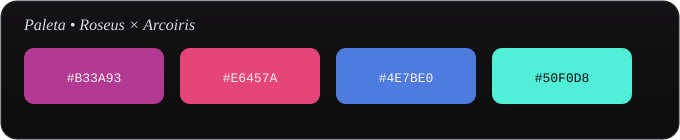

<p align="center">
  <picture>
    <source media="(prefers-color-scheme: dark)" srcset="assets/banner-dark.svg">
    <source media="(prefers-color-scheme: light)" srcset="assets/banner-light.svg">
    
  </picture>
</p>

<p align="center">
  
</p>

<p align="center">
  
  
  
  
  
</p>


## 🐟 Qué es PixelRadar

**PixelRadar** es un proyecto de análisis de datos que responde una pregunta muy concreta para un desarrollador indie: *"si mi juego tiene estos tags en Steam, ¿a qué precio y en qué mes suelen lanzarse juegos parecidos que funcionaron bien?"*

El proyecto recolecta datos reales de juegos indie de Steam (vía SteamSpy y la Store API), entrena un modelo de **K-Nearest Neighbors** sobre sus tags e idiomas soportados, y expone los resultados a través de una pequeña API/web hecha con FastAPI.


## 🫧 Features

- **Dataset propio de juegos indie** ([`indie_games.csv`](indie_games.csv)): ~1654 juegos recolectados con muestreo estratificado por cantidad de owners (bajo / medio / alto), filtrando juegos con al menos 10 reseñas.
- **Modelo KNN** ([`knn_model.py`](knn_model.py)) sobre los 60 tags más frecuentes (one-hot) + cantidad de idiomas soportados (escalado), con distancia coseno.
- **Benchmark automático** por cada consulta:
  - 💲 precio sugerido (mediana y rango P25–P75) calculado solo con vecinos "exitosos" y de pago.
  - 📅 mejores meses de lanzamiento según la frecuencia entre los vecinos.
  - 📊 similitud promedio y porcentaje de vecinos gratuitos.
- **Clasificación de "éxito"**: un vecino se considera exitoso si su cantidad de owners está por encima de la mediana local y tiene ≥ 70% de reseñas positivas.
- **Evaluación leave-one-out** ([`evaluate.py`](evaluate.py)) comparando el KNN (coseno y jaccard, K=5/10/20) contra baselines de mediana global y mediana por género, con MAE y sMAPE.
- **API + mini interfaz web** ([`app.py`](app.py)) para elegir tags, idiomas y K, y ver los resultados sin tocar código.


## 🌊 Resultados de evaluación

Comparación leave-one-out del KNN contra los baselines, tomada de [`data/resultados_evaluacion.csv`](data/resultados_evaluacion.csv):

| K  | Métrica | Evaluados | MAE KNN (USD) | sMAPE KNN (%) | MAE baseline global (USD) | MAE baseline género (USD) |
|----|---------|-----------|----------------|----------------|-----------------------------|------------------------------|
| 5  | coseno  | 1290      | 6.98           | 67.94          | 7.10                        | 7.25                         |
| 10 | coseno  | 1323      | 6.78           | 65.85          | 7.11                        | 7.25                         |
| 20 | coseno  | 1343      | **6.26**       | **62.26**      | 7.08                        | 7.23                         |
| 5  | jaccard | 1292      | 7.55           | 69.41          | 7.09                        | 7.23                         |
| 10 | jaccard | 1335      | 7.11           | 66.94          | 7.07                        | 7.22                         |
| 20 | jaccard | 1346      | 6.47           | 63.28          | 7.07                        | 7.22                         |

El mejor resultado observado es **K=20 con distancia coseno**, levemente por debajo de ambos baselines en error absoluto.

### Interfaz web

<p align="center">
  <!-- TODO: reemplazar por una captura real de la UI en http://127.0.0.1:8000 -->
  
</p>


## 🐠 Instalación

Requisitos: **Python 3.10+**.

```bash
git clone https://github.com/andreacldp/PixelRadar.git
cd PixelRadar

python -m venv .venv
source .venv/bin/activate   # Windows: .venv\Scripts\activate

pip install fastapi uvicorn pydantic pandas numpy scikit-learn requests
```

> El repo todavía no incluye un `requirements.txt`; la lista de arriba son las dependencias que importan `app.py`, `knn_model.py`, `evaluate.py` y `collect_steam.py`.


## 🐟 Uso

### Levantar la API y la mini web

```bash
uvicorn app:app --reload
```

Abrí `http://127.0.0.1:8000`, marcá los tags de tu juego, elegí número de idiomas y K, y apretá **"Buscar juegos parecidos"**.

### Usar la API directamente

```bash
# Lista de tags disponibles (los 60 más frecuentes del dataset)
curl http://127.0.0.1:8000/api/tags

# Pedir recomendación / benchmark
curl -X POST http://127.0.0.1:8000/api/recommend \
  -H "Content-Type: application/json" \
  -d '{"tags": ["Pixel Graphics", "Platformer", "Difficult"], "n_languages": 3, "k": 20}'
```

### Correr el modelo sin la API

```bash
python knn_model.py
```

Imprime un ejemplo de recomendación en JSON usando los tags `["Pixel Graphics", "Platformer", "Difficult"]`.

### Reproducir la evaluación

```bash
python evaluate.py
```

Corre la validación leave-one-out para las combinaciones de K y métrica, e imprime/guarda el resumen en `data/resultados_evaluacion.csv`.

### Regenerar o ampliar el dataset (opcional)

```bash
python collect_steam.py
```

Descarga juegos indie desde SteamSpy y la Steam Store API, con caché y reintentos (`data/.cache/`). Es un proceso largo y resumible: puede interrumpirse y vuelve a correr desde donde quedó usando `indie_games.csv` y `data/dropped_games.csv` como registro de lo ya procesado.


## 🫧 Estructura del proyecto

```
PixelRadar/
├── app.py                      # API FastAPI + mini interfaz web (/, /api/tags, /api/recommend)
├── knn_model.py                # Modelo KNN: features, entrenamiento, benchmark de vecinos
├── evaluate.py                 # Evaluación leave-one-out (KNN vs baselines) -> MAE / sMAPE
├── collect_steam.py            # Recolección del dataset desde SteamSpy + Steam Store API
├── indie_games.csv             # Dataset de juegos indie (~1654 filas)
├── data/
│   ├── dropped_games.csv       # Juegos descartados durante la recolección, con motivo
│   ├── resultados_evaluacion.csv  # Salida de evaluate.py
│   └── .cache/                 # Caché de SteamSpy y de la muestra elegida (para resumir la corrida)
└── assets/                     # Banner, paleta y separadores del README
```


## 🌊 Tecnologías

- **Python** — lenguaje principal.
- **FastAPI** + **Pydantic** — API y validación de requests.
- **scikit-learn** — `NearestNeighbors` (KNN) y `StandardScaler`.
- **pandas** / **NumPy** — manipulación de datos y features.
- **Requests** — consumo de las APIs de SteamSpy y Steam Store.


## 🐠 Créditos y licencia

Datos obtenidos de la [API de SteamSpy](https://steamspy.com/api.php) y de la [Steam Store API](https://store.steampowered.com/api/appdetails), usados con fines de investigación/educativos.

Este repositorio todavía no define una licencia. Si pensás abrirlo públicamente, agregá un archivo `LICENSE` (por ejemplo MIT) para dejar claro cómo se puede usar el código y el dataset.

<p align="center"><sub>Hecho con 🐟 y Python — <a href="https://github.com/andreacldp/PixelRadar">andreacldp/PixelRadar</a></sub></p>
